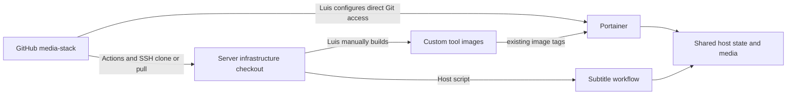

# Current repository architecture

[Documentation map](README.md) · [Implementation evidence](evidence.md)

The repository declares **17 production services in four independent Compose
units**. Membership and service details belong to the stack READMEs linked from
the documentation map. Runtime deployment has not been changed by this task:
Luis last reported one Portainer stack and will perform the four-unit cutover.

The arrows do not imply automatic image builds or deployment. Portainer and the
synchronized checkout are separate consumers. Luis alone controls runtime actions.

## Hard coupling and shared contracts

Both VPN owners stay with all their namespace consumers. Main Gluetun belongs
to acquisition; scraper Gluetun belongs to subtitles. NensaySubs and its solver
retain their loopback relationship. Every declared `depends_on` edge remains
inside its unit. Streaming and management have their own bridge interfaces.

All production units reference existing external `arrnet_managed`; eight static
addresses are unchanged. The old duplicate default alias and project-owned IPAM
were replaced solely to share this network across independent projects. Luis
preserves/prepares the actual network. See [network contract](design/network-and-variables.md).
Application endpoints and shared host files may still couple units operationally;
independent update boundaries do not guarantee immunity from host/storage failures.

| Persisted/shared contract | Operational significance |
| --- | --- |
| `/data/media` | Writable to production Jellyfin, NensaySubs and FFsubsync; read-only to the inactive canary. Writers can affect readers across stack boundaries. |
| `/home/devops/runtime/jellysun/*` | Production Jellyfin and retained inactive canary overlap in writable config/cache/transcode/metadata. Canary requires deliberate isolation before concurrent use. |
| `/data/fast/qbittorrent` | qBittorrent mounts this as `/data`; MakeMKV uses its downloads child. |
| Distinct manager/tool runtime paths | Retained exactly. Do not infer host aliases, remote-path mappings or hardlink behavior. |
| `/home/devops/infra/media-stack/navidrome/music` | New checkout-prefix bind, read-only music; server-only data must be prepared by Luis. |
| `/home/devops/infra/media-stack/yt-dlp/cookies.txt` | New checkout-prefix bind, unchanged subpath; cookie data does not follow the recipe into `tools/`. |
| `/home/devops/infra/jellysun-ui/dist/*` | Existing external plugin DLL binds unchanged. |

All persisted mounts remain binds, not named volumes. Runtime paths under
`/home/devops/runtime/arrstack` remain intentionally unchanged. The `/infra` and
`/runtime` shorthand used by Luis does not replace literal source prefixes.

The deunhealth service/socket and its exclusive qBittorrent label were removed
with authorization; no replacement recovery behavior was introduced. The remote
VueTorrent mod remains while the unused local bundle was deleted. The inactive
canary moved under `canaries/jellyfin`; locally owned tool assets live in `tools/`.
No image tag, VPN identity, media mode, plugin or GPU behavior was upgraded.
